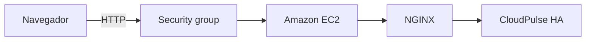

# CloudPulse HA

Panel web desplegado en AWS EC2 para visualizar la identidad de la instancia y comprobar la disponibilidad HTTP de NGINX.


## Características

- Identificación de la instancia y su zona de disponibilidad mediante IMDSv2.
- Comprobación HTTP del servicio NGINX.
- Actualización de los resultados desde la interfaz.
- Manejo de errores de conexión y respuestas inválidas.
- Diseño adaptable a escritorio y dispositivos móviles.

## Tecnologías

| Componente | Tecnología |
|---|---|
| Interfaz | HTML, CSS y JavaScript |
| Servidor web | NGINX |
| Sistema operativo | Amazon Linux 2023 |
| Infraestructura | EC2 t3.micro · eu-west-1a |
| Almacenamiento | EBS gp3 · 8 GiB · cifrado |
| Seguridad | IMDSv2 obligatorio y acceso de red restringido |

## Arquitectura



Implementación de una instancia EC2. La identidad se genera durante el despliegue; el estado HTTP se comprueba desde el navegador.

## Validación

NGINX respondió **HTTP 200**. Las comprobaciones de sistema, instancia y almacenamiento de AWS finalizaron correctamente.

[Resultados y evidencias](docs/RESULTADOS.md)

## Estructura

```text
cloudpulse-ha/
├── index.html
├── styles.css
├── deployment.js
├── deploy/
│   └── install-nginx.sh
├── tests/
│   └── deployment.test.cjs
├── docs/
│   └── RESULTADOS.md
└── evidence/
    ├── cloudpulse-web.png
    └── ec2-status-checks.png
```

**Estado:** despliegue de demostración finalizado. Código y evidencias disponibles en este repositorio.
