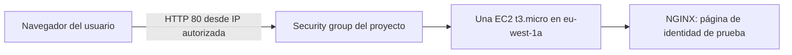
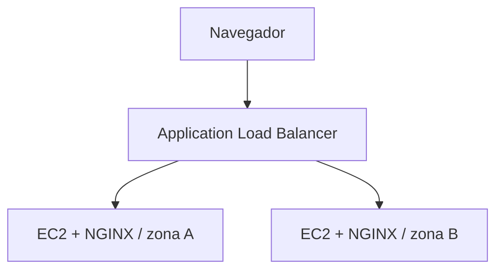

# Arquitectura

## Prueba real realizada

La EC2 utilizó Amazon Linux 2023, una IP pública temporal, disco gp3 de 8 GiB cifrado y metadatos con IMDSv2 obligatorio. Una sola EC2 es un punto único de fallo. El usuario desplegó una primera versión de la interfaz. La actualización que retira la demo está preparada para volver a instalarse.

## Objetivo de alta disponibilidad, aún no implementado

El ALB detectaría destinos no saludables y enviaría tráfico a los que estén saludables. La recuperación automática de capacidad requeriría un Auto Scaling Group; no está implementado. La pantalla actual no muestra inventarios ficticios ni recursos futuros.
