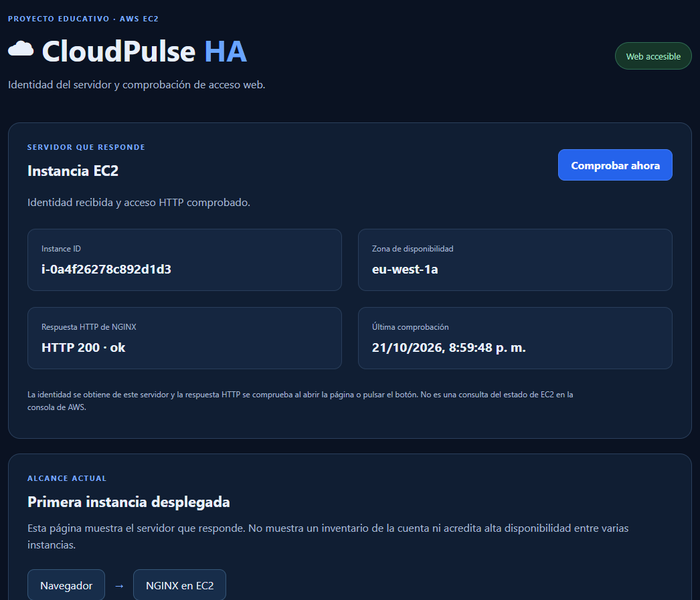
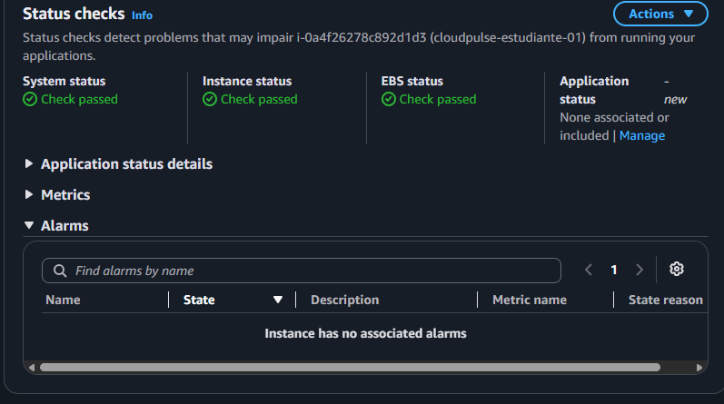

# Resultados del proyecto

Evidencias del despliegue realizado el 21 de octubre de 2026.

| Comprobación | Resultado |
|---|---|
| Página servida por NGINX | HTTP 200 · ok |
| Identidad mostrada | `i-0a4f26278c892d1d3` |
| Zona de disponibilidad | `eu-west-1a` |
| Estado del sistema EC2 | Check passed |
| Estado de la instancia EC2 | Check passed |
| Estado de EBS | Check passed |
| Interfaz | Sin servidores ni contadores simulados |
| Pruebas locales de JavaScript | Aprobadas: identidad válida, datos inválidos, errores HTTP, comprobación parcial y actualización manual |

## Web desplegada

## Comprobaciones de AWS

La captura de AWS no muestra alarmas asociadas ni comprobaciones de aplicación configuradas. La respuesta HTTP de la web es una comprobación separada de NGINX.

Los resultados corresponden a una sola EC2; no acreditan redundancia, balanceo ni recuperación automática.

## Cierre

La limpieza de los recursos de prueba fue confirmada por el responsable del proyecto. El código y las evidencias se conservan como registro del trabajo realizado.
